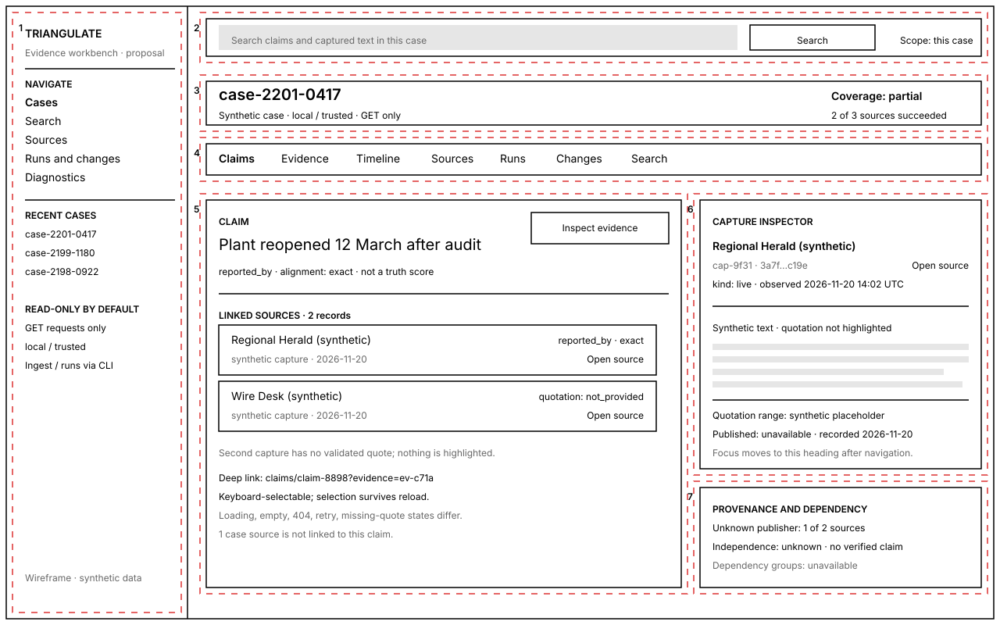

# Evidence workbench wireframe (desktop, proposal)

Date: 2026-11-23. Status: **proposal wireframe, not shipped.** Static design artifacts only:
no application code, runtime, schema or API changed. All case names, IDs, URLs, quotes and
counts in the SVG are **synthetic** and use `example.invalid`. The wireframe is an
illustration of the [evidence workbench specification](20261114-evidence-workbench-specification.md),
not evidence that any capability in it exists in the product.



Source file: [`20261123-evidence-workbench-wireframe.svg`](20261123-evidence-workbench-wireframe.svg)
(standalone, 108 lines, no external dependencies).

Specification anchors: §1 objective and release boundaries, §2 non-negotiable invariants,
§4 Capability E1 (claim → quotation → immutable capture inspector), §5 Capability E2 for
the provenance/dependency pane, §9 for the GET-only contracts implied by each action.

## 1. What this screen is

A single case-scoped reading screen for the first workbench capability: read a claim, see
which captured sources report it, inspect the exact captured text, and see honest
provenance. It deliberately replaces dashboard decoration (KPI tiles, gauges, scores)
with a compact source list, because the open questions are *what was asserted, where, and
what is missing* — not *how confident is the machine*.

Only GET/navigation actions appear: **Inspect evidence** (claim-level primary action) and
**Open source** (per-row and inspector link, HTTP(S) only, new tab with
`noopener noreferrer` in implementation). There is no ingest, run, retry-write, review or
annotation button. The three narrow human review POSTs accepted by the 2026-11-22
amendment in spec §1 are out of scope for this screen and are not drawn.

## 2. Numbered annotation list

Numbers match the `data-region` values on the dashed callout rectangles in the SVG.

1 — Primary navigation: 240 px column with product identity, five destinations, recent cases, and a read-only reminder (GET reads; ingest and runs via CLI); case selection navigates and never mutates.
2 — Case-scoped search toolbar (y24–72): one literal-term field, a GET submit, and an explicit "Scope: this case"; no global search and no existing index are claimed.
3 — Case identity and coverage (y104–160): synthetic case ID, environment and read-only framing; observed `partial` coverage "2 of 3 sources succeeded", a reported acquisition outcome, never a truth or completeness score.
4 — Case tabs (y184–224): Claims, Evidence, Timeline, Sources, Runs, Changes, Search; the active tab is bold rather than color-only; deep links pin `claim`, `evidence`, `capture`, `snapshot`.
5 — Claim and linked sources (x264–872, y256–752): claim text, effective relationship `reported_by`, alignment state, "not a truth score"; two linked source rows (one exact quotation, one `not_provided`), so 1 of the 3 covered sources is unlinked to this claim; footer notes deep-link shape, keyboard behavior and distinct states.
6 — Immutable capture inspector (x896–1256, y256–600): capture ID, short hash, `live` kind, observation time, grey placeholder body labelled synthetic and unhighlighted, `Published: unavailable`, and "Quotation range: synthetic placeholder" — no validated offsets are claimed.
7 — Provenance and dependency context (x896–1256, y624–752): unknown publisher remainder out of 2 relevant sources, `Independence: unknown · no verified claim`, and `Dependency groups: unavailable` — no grouping, policy or version is inferred.

## 3. Reading-order and geometry notes

Reading order follows the analyst's task: where am I (1) → find something (2) → which
case, how complete (3) → which view (4) → the claim and its sources (5) → the captured
text (6) → how the sources relate (7). The claim pane is wider than the inspector because
source scanning is a list task; the inspector and provenance panes share the right rail
and a 24 px gutter. All geometry is 8 px aligned (see §6), so a reviewer can hand-count
grid steps; the left column is 240 px with a 24 px gutter to the 992 px main column.

## 4. States that must look different (not drawn, listed for implementation)

The screen must render these as visually and textually distinct states; none of them may
collapse into "no results":

- **Loading** — pending request, no partial claim/source rows asserted.
- **Empty** — the case genuinely has no claims; a valid `200` with no rows.
- **404** — unknown case/claim/evidence/capture/citation ID, including wrong-case IDs
  requested by a deep link (no silent redirect to another item).
- **Network error with retry** — failed read, retryable, distinguishable from empty.
- **Missing quotation** — the link exists but no validated quotation exists
  (`not_provided`, `source_unavailable`, `ambiguous`, `no_match`; spec §4), so nothing is
  highlighted and the reason is stated.
- **Unavailable capture or field** — capture text or publication time not known
  (`unavailable`, not zero, not fabricated).

The inspected state of each of these belongs in follow-up state variants if the owner
wants them; see §6 variants rule.

## 5. Assumptions and tradeoffs

- **One screen, no flow diagram.** A single case screen has no cross-screen transition to
  diagram, so no `*-flow.svg` was produced.
- **Desktop canvas only.** Only 1280×800 was drawn; the tablet 768×1024 and mobile
  375×812 canvases in §6 exist but were not requested, so no tablet or mobile artifact
  was produced.
- **12 px floor for type.** Source metadata that would need 10 px (full URL, canonical
  URL, publisher key, extraction scope, collector/prompt metadata, `recorded_at`,
  observation history) is intentionally omitted from the SVG and summarized here
  instead, rather than shrunk below the readable minimum.
- **Annotation layer over UI layer.** Region callouts are an 8 px offset outline drawn on
  top of the UI layer and nothing else; region numbers are black text in the gutter so
  the callouts do not paint over UI content or rely on red alone to be identified.
- **Bold as the only "active" cue.** Active nav item and active case tab are bold instead
  of a colored underline, because the palette has no accent color outside the annotation
  layer. Implementation can use an underline or weight change, not color-only.
- **Placeholder body text.** Drawing a realistic captured paragraph would imply a real
  validated quotation, so the inspector shows grey placeholder lines plus an explicit
  synthetic-text label; the quotation line reads "Quotation range: synthetic
  placeholder" and claims no validated offsets or highlighted span. Any future variant
  that depicts a validated quotation must label it a synthetic example.
- **Claim list is a list, not a table.** Two rows fit the width with two lines each; a
  table with every provenance column would force < 12 px type.
- **Numbers are illustrative.** `case-2201-0417`, `claim-8898`, `ev-c71a`, `cap-9f31`
  and the hash prefix are fabricated for layout, not real records.
- **Not verified in a browser matrix.** The file was rendered once in headless Chromium
  at 1280×800 to check overflow, alignment and annotation legibility. No Safari/Firefox
  pass, no screenshot baselines, no accessibility-tree audit were produced; the SVG is a
  design artifact, not a shipped asset.

## 6. Reusable generator instructions (for the next screen)

These rules reproduce this wireframe's style; keep them when adding screens.

**Output.** In the reply, post one fenced ```svg block containing the complete standalone
file plus a short textual list of the numbered regions; always also write that same SVG
file next to its dated brief (`docs/plans/YYYYMMDD-<topic>-wireframe.svg`). The drawing
itself marks proposal status (the muted `#666` caption such as "Wireframe · synthetic
data") and the brief carries date and status, so do not add a second proposal banner to
the artwork. Never emit HTML, inline SVG-in-HTML, external CSS/JS, web fonts, raster
images or build steps; keep files small and hand-editable (~80–130 lines).

**Canvas.** Three sanctioned sizes, each with its own viewport comment as the first line:
desktop `width="1280" height="800" viewBox="0 0 1280 800"` + `<!-- viewport: 1280×800
desktop -->`; tablet `width="768" height="1024" viewBox="0 0 768 1024"` + `<!-- viewport:
768×1024 tablet -->`; mobile `width="375" height="812" viewBox="0 0 375 812"` +
`<!-- viewport: 375×812 mobile -->`. Default white canvas with an 8 px inset black outer
border (e.g. `x="8" y="8" width="1264" height="784"`) so the 1.5 px stroke is not clipped
at the viewBox edge.

**Grid.** Every `x`, `y`, `width`, `height`, `x1`, `x2`, `y1`, `y2` and every text baseline
is a multiple of 8. Text baselines count as coordinates. Keep major gutters at 24 px and
callout offsets at 8 px. Do not introduce off-grid nudges to fix a cramped label; move
the label to a gutter instead.

**Mobile exception.** A mobile screen may use a **375×812** canvas even though neither
dimension is a multiple of 8 (812/8 = 101.5, 375/8 = 46.875). Only the canvas is exempt:
derive the drawing area as the largest 8-aligned inset (e.g. 8→368 wide, 8→808 tall), keep
all internal shapes and baselines on the 8 px grid, and accept the residual asymmetric
right/bottom margin. Do not round the canvas to 376×816 to satisfy the grid rule.

**Type.** `font-family="-apple-system, system-ui, sans-serif"` (set once on each top-level
`g`). Font sizes **only** 12, 14, 20, 28. 12 = metadata and annotations, 14 = list items,
labels and buttons, 20 = claim/case titles, 28 reserved for a screen title. No other
sizes, no letter-spacing tricks, no images of text.

**Palette and strokes.** Borders, dividers and outlined boxes: `stroke="#000"` with
`stroke-width="1.5"`. Box fills: `#fff`. Placeholder/input/text-block fills: `#e6e6e6`.
Labels and body text: `#000`. Placeholder and mock text: `#666`. Annotation layer: `#d33`
only, dashed, text-free of color. Nothing else — no gradients, shadows, filters, opacity
washes, icon fonts or additional colors. Weight (`font-weight="600"`) is the only
sanctioned emphasis.

**Elements.** `<rect>`, `<line>`, `<text>`, `<g>`, plus `<title>`/`<desc>` only. No
`<path>`, `<circle>`, `<ellipse>`, `<polygon>`, `<image>`, `<use>`, `<defs>`, `<style>`,
`<script>`, markers or masks. Buttons and tabs are rectangles plus centered `<text>`.

**Accessibility.** Root element carries `role="img"` and
`aria-labelledby="<titleId> <descId>"`; include a `<title>` naming the screen and a
`<desc>` naming every numbered region, stating that it is a proposal and that content is
synthetic. Minimum type 12 px, black-on-white or `#666`-on-white contrast only, and no
meaning carried by color alone — the annotation layer's red is always paired with black
numbers and the brief's numbered list. Do not encode state in hue; use words and weight.

**Annotation layer.** The final child of `<svg>` is `<g id="annotations">` containing
**only** dashed outline rectangles (`stroke="#d33" stroke-width="1.5"
stroke-dasharray="8 8"`, `fill="none"`) and black numeric `<text>` labels. Each rectangle
carries `data-region="1"…"N"` in reading order, is offset 8 px outside its UI region, must
not overlap another callout, and must stay fully inside the viewBox. Numbers sit in
gutters or 8 px bands, never on top of UI text or boxes, and must match the numbered list
in the companion brief one-to-one.

**Variants.** Optional, never assumed. Generate a state variant only when the request
names the state; each state is its own file
(`YYYYMMDD-<topic>-wireframe--<state>.svg`): loading, empty, 404, network-error-retry,
missing quotation, unavailable field. Do not draw a state the request did not ask for
inside the primary screen. State variants are separate from the structural variants
below and never replace the primary screen.

**Structural variation mode.** When the request asks for layout options, produce 2–3
structural variants of the same screen with identical tokens, identical content and
identical annotation rules; vary exactly one named axis per variant (for example
"navigation placement", "claim list density" or "inspector prominence") and name that axis
in each `<title>`. Emit each variant as its own SVG
(`YYYYMMDD-<topic>-wireframe--<axis>-<n>.svg`) and list the tradeoffs in the brief in this
order: scannability, density, action visibility. Do not combine axes in one variant, do
not put variants in one file, and do not invent data differences between them.

**Multiple screens.** If the request covers more than one screen, also emit
`YYYYMMDD-<topic>-flow.svg` on a sanctioned canvas (desktop by default) containing actual
scaled thumbnails of each screen placed left to right in navigation order: each thumbnail
is a grid-aligned `<rect>` with a caption and a uniform scale factor recorded in the
brief; transitions are 1.5 px `<line>` segments with arrow heads drawn as two short
`<line>` segments (no `<path>`, no markers, no icons), each with a short text caption.
Thumbnail positions, arrow endpoints and captions stay on the 8 px grid. Keep every
screen in its own SVG; the flow file never embeds full-size screens. For a single screen,
emit no flow file — this brief covers one screen, so none exists.

**Content honesty.** Use `example.invalid` hosts, obviously synthetic IDs, and short
labels. Source names are display names only (`Regional Herald (synthetic)`, `Wire Desk
(synthetic)`); fake URLs and metadata stay in the companion brief, not in the drawing.
Counts must agree with each other (3 covered sources, 2 linked, 1 unlinked) and repeated
numbers use the same value. Implemented invariants the drawing must not contradict:
capture is not verification; a quotation is not entailment; missing data is not zero;
independence is `unknown` unless a dependency is detected; a detected identity/copy edge
does not make a grouping policy versions or counts; generated links are `reported_by` or
`uncertain` only; GET views trigger no analysis, recapture or indexing.

**Input variables.** Fill this template before drawing; anything unknown is written as
`unknown` in the output rather than invented.

| Variable | Meaning |
|---|---|
| `screen` / `flow` | One screen (no flow file) or N screens (emit the flow file) |
| `product` / `domain` | Product name plus the analyst task the screen serves |
| `viewport` | `1280×800 desktop`, `768×1024 tablet` or `375×812 mobile` |
| `structural requirements` | Panes, regions, reading order and actions that must exist |
| `variation axis` | Optional: the single axis to vary across 2–3 structural variants |

**Quality checks before handing off.** Confirm, and state in the reply:

- **Grid:** every `x`, `y`, `width`, `height`, `x1`, `x2`, `y1`, `y2` and text baseline is
a multiple of 8, except a 375×812 canvas size itself; annotation rects are non-overlapping
and inside the viewBox.
- **Palette and type:** only the sanctioned paints, weights and font sizes 12/14/20/28;
no element outside the `rect`/`line`/`text`/`g`/`title`/`desc` allowlist.
- **Annotation map:** `data-region` values run 1…N in reading order, labels sit in
gutters without covering UI, and each label has exactly one entry in the brief's
single-line region list.
- **Flow completeness (multi-screen only):** every screen appears once, thumbnails and
arrows are grid-aligned and captioned, no screen is orphaned and no transition is
implied that the brief does not describe.
- **Honesty:** no scores, no invented records, counts consistent, no real URLs, and no
state that the request did not ask for.

## 7. Next steps (owner-gated)

1. Owner review of the layout and the reading order in §3 (this document is not
   authorization to build).
2. If approved, the state variants in §4 need explicit scoping; each is a separate
   artifact and a separate implementation ticket.
3. Implementation must follow spec §4 acceptance (code-point quotation ranges, immutable
   captures, distinct reader states) rather than this drawing. This wireframe is not a
   substitute for a design spec, an API contract or a test plan.
